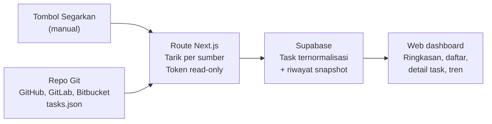

# PRD: Web Monitoring Task Master

6 November 2026 · Otik

## Ringkasan dan latar belakang

Website ini menampilkan task master dari semua aplikasi yang didaftarkan dalam satu dashboard read-only, sehingga progres semua aplikasi terlihat tanpa membuka repository satu per satu.

Setiap aplikasi menyimpan task master (Taskmaster) sebagai file `tasks.json` di repository-nya. Letak file, branch, dan penyedia repository bisa berbeda antar aplikasi (tidak hanya GitHub), dan server tiap aplikasi ada yang sama dan ada yang berbeda, jadi tidak ada satu database tempat semua task bisa dibaca. Saat ini progres dicek dengan membuka tiap repository secara manual.

Satu hal sudah terbukti: `tasks.json` milik repo echoapp (branch `stg`) berhasil dibaca lewat GitHub API dengan status 200 OK, ukuran sekitar 660 KB. Artinya sumber datanya bisa dijangkau tanpa menyentuh server aplikasi.

## Tujuan, non-tujuan, dan metrik

Tujuan utamanya satu: dalam satu layar, orang bisa melihat status task master seluruh aplikasi dan menemukan yang bermasalah.

**Tujuan**

- Menggabungkan task master dari semua aplikasi yang terdaftar ke satu tampilan; jumlah aplikasi tidak tetap, dan sumber bisa ditambah, diubah, atau dinonaktifkan lewat form (penyedia repo, URL, branch, path file, token) tanpa mengubah kode.
- Menampilkan ringkasan status per aplikasi: jumlah task per status dan persentase selesai.
- Memudahkan mencari task lintas aplikasi (filter aplikasi, tag, status, prioritas).
- Menyimpan riwayat dan menampilkan tren progres tiap aplikasi dari waktu ke waktu.
- Menunjukkan kapan data terakhir disinkronkan dan sumber mana yang gagal diambil.

**Non-tujuan (versi awal)**

- Mengubah task dari website. Task tetap dikelola lewat Taskmaster di masing-masing repo.
- Menggantikan tools manajemen proyek lain (Jira, Trello, dan sejenisnya).
- Memantau kondisi server atau deployment aplikasi.

**Metrik keberhasilan**

| Metrik | Target awal |
| --- | --- |
| Waktu untuk melihat status semua aplikasi | Kurang dari 1 menit, tanpa membuka repo |
| Usia data paling lama saat dilihat | Terlihat dari waktu sinkron terakhir; data dimutakhirkan lewat tombol Segarkan |
| Repo yang berhasil disinkronkan per siklus | 99% atau lebih; kegagalan terlihat jelas di layar |
| Waktu muat halaman utama dari cache | Kurang dari 2 detik |

## Pengguna dan kebutuhan

Peran di bawah adalah asumsi awal. Semua pengguna yang sudah login boleh melihat semua aplikasi; hanya admin yang mengelola sumber.

| Pengguna | Kebutuhan utama |
| --- | --- |
| Pimpinan teknis / product | Gambaran progres seluruh aplikasi dalam satu layar, dan tahu aplikasi mana yang tertinggal |
| Developer | Menemukan task berikutnya dan task yang terblokir dependensi, per aplikasi |
| Manajemen / stakeholder | Persentase progres dan status terkini, hanya dibaca, tanpa istilah teknis |

## Lingkup fitur

Versi pertama (MVP) cukup membaca dan menampilkan; sinkronisasi terjadwal, task terblokir, dan notifikasi menyusul.

| Fitur | Fase |
| --- | --- |
| Login email dan password (Supabase Auth); akun dibuat lewat seeder database, tanpa pendaftaran publik | MVP |
| Pengaturan sumber dinamis: nama aplikasi, penyedia repo (GitHub, GitLab, Bitbucket), URL repo, branch, path file task master, token, dan uji koneksi | MVP |
| Sinkronisasi manual lewat tombol Segarkan, per sumber atau semua sumber | MVP |
| Ringkasan per aplikasi: jumlah task per status dan persentase selesai | MVP |
| Daftar semua task lintas aplikasi dengan filter aplikasi, tag, status, prioritas | MVP |
| Detail task: deskripsi, dependensi, subtask, strategi pengujian | MVP |
| Riwayat dan tren progres per aplikasi dari snapshot setiap sinkronisasi | MVP |
| Penanda sumber yang gagal diambil, dengan data terakhir yang berhasil | MVP |
| Sinkronisasi terjadwal otomatis (opsional) | Tahap 2 |
| Task terblokir dan task siap dikerjakan | Tahap 2 |
| Pencarian teks pada judul dan deskripsi | Tahap 2 |
| Adapter penyedia lain (Gitea, self-hosted) | Tahap 2 |
| Notifikasi (Slack atau email) untuk task macet | Tahap 3 |
| Sinkronisasi real-time lewat webhook push | Tahap 3 |

## Sumber data dan arsitektur

Satu route handler Next.js di Vercel menarik task master dari semua sumber yang terdaftar dan menyimpannya di Supabase; website hanya membaca dari Supabase.

Hanya server yang memegang token; website dan browser membaca hasil dari penyimpanan.

1. Admin mendaftarkan sumber lewat form: nama aplikasi, penyedia repo, URL repo, branch, path file task master, dan token akses.
2. Tombol Segarkan memanggil server Next.js, yang mengambil file dari API penyedia repo sesuai konfigurasi sumber itu. Untuk GitHub: `GET /repos/{owner}/{repo}/contents/{path}?ref={branch}` dengan header `Accept: application/vnd.github.raw+json`.
3. Isi file dinormalisasi, apa pun bentuknya (`{ "master": { "tasks": [...] } }` atau `{ "tasks": [...] }`), disimpan ke Supabase, dan satu snapshot jumlah task per status dicatat.
4. Website membaca dari Supabase; browser tidak memanggil penyedia repo dan tidak pernah menerima token.

Tiap penyedia repo dibungkus satu adapter dengan kontrak yang sama: ambil file mentah dari URL, branch, dan path. GitHub, GitLab, dan Bitbucket didukung sejak MVP; penyedia lain ditambah tanpa mengubah halaman. Letak server aplikasi tidak berpengaruh.

## Kebutuhan fungsional

Website MVP terdiri dari enam halaman.

| Halaman | Isi dan perilaku |
| --- | --- |
| Login | Email dan password lewat Supabase Auth. Tidak ada pendaftaran publik; akun (termasuk admin awal) dibuat lewat seeder database, tanpa halaman manajemen akun di MVP. Password awal sebaiknya diganti setelah login pertama. |
| Dashboard | Satu kartu per aplikasi: jumlah task per status (pending, in-progress, review, blocked, done, deferred, cancelled), persentase selesai, waktu sinkron terakhir, dan penanda gagal sinkron. Tombol Segarkan untuk satu aplikasi atau semua. Klik kartu membuka daftar task aplikasi itu. |
| Daftar task | Tabel semua task lintas aplikasi: aplikasi, tag, ID, judul, status, prioritas, jumlah subtask selesai dari total. Filter aplikasi, tag (semua tag yang ada di file sumber), status, prioritas; urutkan per kolom. |
| Detail task | Judul, deskripsi, detail implementasi, strategi pengujian, daftar dependensi (dapat diklik), dan subtask beserta statusnya. |
| Tren | Grafik jumlah task per status dan persentase selesai dari waktu ke waktu, per aplikasi dan gabungan, dengan rentang waktu yang bisa dipilih. Datanya dari snapshot tiap sinkronisasi. |
| Pengaturan sumber (admin) | Form tambah atau ubah sumber: nama aplikasi, penyedia repo, URL repo, branch, path file task master, token. Token tidak pernah ditampilkan lagi setelah disimpan. Ada tombol Uji koneksi, nonaktifkan, dan hapus. |

Aturan umum:

- Semua halaman hanya menampilkan data, tidak ada aksi yang mengubah task.
- Jika satu repo gagal diambil, data lainnya tetap tampil dan repo itu diberi penanda beserta pesan galatnya.
- Tombol Segarkan menjalankan sinkronisasi ulang dan menampilkan hasilnya per aplikasi.

## Kebutuhan non-fungsional

Yang paling penting adalah keamanan token akses repository, karena website menyimpannya dan token itu membuka akses ke kode semua aplikasi.

**Keamanan**

- Token diisi admin lewat form dan disimpan terenkripsi di Supabase (enkripsi di aplikasi dengan kunci di environment Vercel, atau Supabase Vault). Token hanya dibaca kode server, tidak pernah dikirim ke browser, dan tidak ditampilkan kembali.
- Tabel sumber dilindungi Row Level Security sehingga kolom token tidak terbaca dari sisi klien.
- Gunakan token baca-saja per sumber (GitHub: fine-grained token dengan Contents: Read-only; penyedia lain: scope baca repository). Token classic dengan scope `repo` bersifat baca-tulis dan dihindari.
- Login wajib. Pendaftaran publik dimatikan; hanya admin yang mengelola sumber; akun dibuat lewat seeder database. Semua pengguna yang sudah login boleh melihat semua aplikasi.
- Token punya masa berlaku; kedaluwarsanya dicatat dan galat karena token ditampilkan jelas, bukan sebagai data kosong.

**Performa**

- Hasil sinkronisasi disimpan di Supabase dan halaman membaca dari sana, bukan dari penyedia repo. Satu file sekitar 660 KB per sumber.
- Tiap sumber disinkronkan lewat permintaan server terpisah agar tidak melewati batas waktu fungsi Vercel; Segarkan semua menjalankannya paralel dan melaporkan hasil per sumber.
- Pakai permintaan bersyarat (ETag) bila penyedia mendukungnya, agar file yang tidak berubah tidak diunduh ulang.

**Keandalan**

- Satu repo yang gagal tidak menggagalkan sinkronisasi repo lain.
- Saat sinkronisasi gagal, tampilkan data terakhir yang berhasil dengan penanda usang dan waktu sinkron terakhirnya.

## Model data

Format `tasks.json` dari Taskmaster dinormalisasi menjadi empat entitas supaya task dari semua aplikasi bisa difilter bersama.

| Entitas | Isi utama |
| --- | --- |
| Sumber | Nama aplikasi, penyedia repo (GitHub, GitLab, dan lainnya), URL repo, branch, path file task master, token terenkripsi, aktif atau tidak, status dan waktu sinkron terakhir, pesan galat |
| Task | Sumber, tag, ID task, judul, deskripsi, status, prioritas, dependensi, detail, strategi pengujian, subtask beserta status; diperbarui tiap sinkronisasi |
| Snapshot | Dibuat tiap sinkronisasi berhasil: waktu, sumber, tag, jumlah task per status (pending, in-progress, review, blocked, done, deferred, cancelled; status lain yang tidak dikenal dihitung sebagai "other"); dasar riwayat dan tren |
| Pengguna | Dikelola Supabase Auth (email dan password) dengan peran admin atau viewer |

File Taskmaster versi baru mengelompokkan task per tag (`{ "master": { "tasks": [...] } }`), sedangkan versi lama langsung `{ "tasks": [...] }`. Pembaca data harus mengenali kedua bentuk, dan ID task hanya unik di dalam satu kombinasi sumber dan tag.

## Risiko dan asumsi

Risiko terbesar bukan teknis: dashboard hanya seakurat isi `tasks.json` yang sudah di-commit ke branch yang dipantau.

| Risiko / asumsi | Dampak | Penanganan |
| --- | --- | --- |
| Status task diubah lokal dan belum di-commit atau di-push | Dashboard menampilkan progres lebih lambat dari kenyataan | Sepakati commit `tasks.json` rutin; tampilkan waktu commit terakhir file |
| Sinkron hanya manual, snapshot hanya terbentuk saat ada yang klik Segarkan | Tren punya celah dan kurang akurat | Tampilkan waktu sinkron terakhir; tambah sinkron harian terjadwal (Tahap 2) bila celah mengganggu |
| Token disimpan di database | Bocornya database membuka akses ke kode | Enkripsi, Row Level Security, token baca-saja, akses hanya dari server, bisa dicabut per sumber |
| Path, branch, atau URL diisi salah | File tidak ditemukan atau data kosong | Tombol Uji koneksi sebelum menyimpan; galat jelas, bukan dianggap 0 task |
| API tiap penyedia repo berbeda | Pengambilan file gagal pada penyedia tertentu | Satu adapter per penyedia dengan kontrak sama; GitHub, GitLab, Bitbucket sejak MVP |
| Branch yang dipantau berbeda dengan yang berjalan di produksi | Data tidak mewakili kondisi produksi | Branch acuan ditetapkan per sumber dan ditampilkan di layar |
| Batas waktu fungsi Vercel dan rate limit penyedia | Sinkronisasi terputus atau tertunda | Satu permintaan per sumber, ETag bila ada, hasil dilaporkan per sumber |
| Bentuk `tasks.json` berbeda antar versi atau tag | Parser gagal atau data kosong | Mendukung bentuk per-tag dan `{ tasks }`; sumber yang tidak cocok ditandai gagal |

## Rencana rilis

Rilis dibagi empat fase; tanggal belum ditetapkan dan ditentukan kemudian.

| Fase | Isi | Dianggap selesai bila |
| --- | --- | --- |
| 0. Validasi data | Script agregator menarik `tasks.json` dari semua repo yang dipantau ke satu file | Semua repo yang didaftarkan terbaca, jumlah task per aplikasi sesuai harapan |
| 1. MVP | Next.js di Vercel, Supabase (database dan Auth), pengaturan sumber dinamis (GitHub, GitLab, Bitbucket), sinkron manual, snapshot, dashboard, daftar task, detail, tren | Tim bisa menambah sumber sendiri dan memantau semua aplikasi beserta trennya dari website |
| 2. Otomatis dan lanjutan | Sinkron terjadwal (opsional), task terblokir, pencarian, adapter penyedia lain (Gitea, self-hosted) | Tren tidak bolong dan penyedia repo lain terbaca tanpa mengubah halaman |
| 3. Notifikasi dan real-time | Webhook push, notifikasi task macet | Perubahan di repo muncul di dashboard dalam hitungan menit |

## Keputusan dan pertanyaan terbuka

Semua pertanyaan awal sudah dijawab dan dimasukkan ke bagian lain dokumen ini. Tabel di bawah merangkum keputusannya; yang masih perlu diputuskan ada di daftar sesudahnya.

| Topik | Keputusan |
| --- | --- |
| Sumber | Dinamis lewat form: penyedia repo, URL, branch, path file, token. Letak file dan branch bisa berbeda per aplikasi |
| Penyedia repo | GitHub, GitLab, Bitbucket sejak MVP; penyedia lain menyusul |
| Login | Email dan password (Supabase Auth), tanpa pendaftaran publik; akun (termasuk admin awal) dibuat lewat seeder database dengan email dan password default |
| Akses | Semua pengguna yang sudah login boleh melihat semua aplikasi; hanya admin yang mengelola sumber |
| Kesegaran data | Manual lewat tombol Segarkan |
| Riwayat dan tren | Dibutuhkan; snapshot tiap sinkronisasi, masuk MVP; untuk saat ini terbentuk dari klik Segarkan saja |
| Hak akses data | Read-only, hanya untuk monitoring |
| Tag | Bisa berbeda per sumber; semua tag ditampilkan sebagai filter |
| Stack | Next.js, database Supabase, deploy di Vercel |
| Token | Per sumber; disimpan terenkripsi di database (diizinkan) |
| Status task | Tujuh status: pending, in-progress, review, blocked, done, deferred, cancelled. `blocked` ditandai manual oleh developer di tasks.json dan ditemukan di data asli (Fase 0); status tak dikenal dihitung "other" agar sinkronisasi tidak gagal |

**Masih terbuka**

Tidak ada. Tanggal rilis tiap fase ditentukan kemudian.
